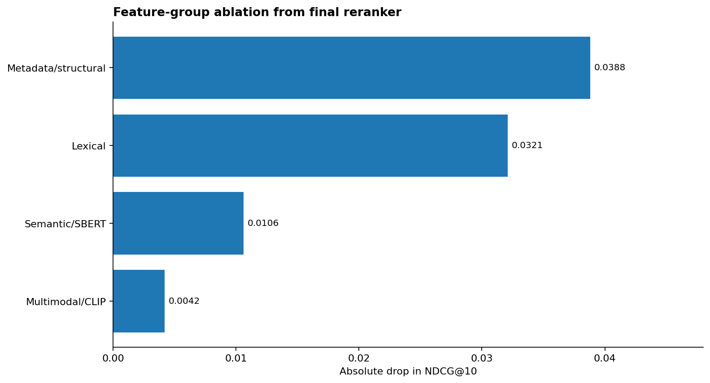
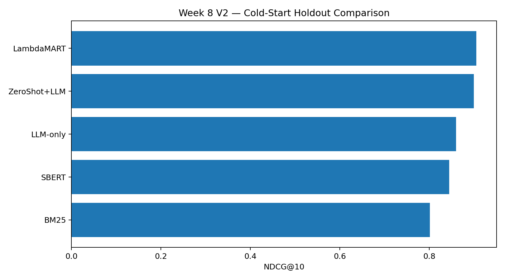

# E-Commerce Search & Learning-to-Rank System

**An eight-week end-to-end e-commerce product search project** combining lexical, semantic, and multimodal retrieval with supervised learning-to-rank, zero-shot cold-start support, and a FastAPI + Streamlit demo.

> **Independent technical portfolio; not an official Amazon code release.** Developed using the public Amazon Reviews (2018) research ecosystem. The user-provided archive contained these source files; the author must verify any internship/employer publication rights before public distribution. Reported experimental results are from the original technical report, **not independently rerun for this GitHub release**.


## Headline results

| Metric | Result | Scope |
|:--|--:|:--|
| **LambdaMART NDCG@10** | **0.9297** | Fixed 200-query reranking candidate set |
| **Improvement over BM25** | **+15.75%** | Same reranking candidate set |
| LambdaMART MRR | 0.9667 | Same reranking candidate set |
| ZeroShot+LLM NDCG@10 | 0.8990 | Separate 45-query cold-start holdout |
| V1.3 fresh mean latency | 83.94 ms | Week 7 serving optimization benchmark |
| V4 packaged mean latency | 119.95 ms | Separate packaged system recheck |

**Do not compare scores across different evaluation scopes as one leaderboard.**


## What is actually in this repository?

This repository now contains the **historical source code**: 28 selected Google Colab notebooks from Weeks 1–8, FastAPI search service code, Streamlit demo source, Docker / API test files, the revised final technical report, plots and small aggregate benchmark tables.

```text
.
├── README.md
├── notebooks/
│   ├── week01/  # preprocessing and EDA
│   ├── week02/  # TF-IDF and BM25
│   ├── week03/  # Llama 3 query understanding
│   ├── week04/  # SBERT, FAISS, CLIP and hybrid retrieval
│   ├── week05/  # LambdaMART, XGBoost, ListNet
│   ├── week06/  # zero-shot / LLM cold start
│   ├── week07/  # serving and optimization experiments
│   └── week08/  # final evaluation, ablation and diagnostics
├── app/         # FastAPI, Streamlit, tests and Docker source
├── assets/      # plots and architecture diagrams
├── results/     # small aggregate CSV benchmarks
├── docs/        # final PDF and evaluation documentation
├── scripts/     # checks and local artifact restoration
└── tests/
```

The **product catalog, saved embeddings, trained model weights, source ZIP intermediates, and raw human-judgment files are not included** in the public package. Those are needed for full local execution. See [reproduction guide](docs/reproduction.md).

## Methodology: Week 1–8

| Week | Milestone | Methods |
|:--|:--|:--|
| 1 | Preprocessing and product relevance | pandas, Parquet, EDA, proxy labels |
| 2 | Lexical ranking baseline | TF-IDF, BM25, cosine similarity, NDCG/Recall/MRR |
| 3 | Query understanding | local Llama 3 via Ollama, intent, attributes, rewriting |
| 4 | Dense + multimodal retrieval | SBERT, FAISS, CLIP, hybrid fusion |
| 5 | Learning-to-rank | XGBoost pointwise, LambdaMART, ListNet, ablations |
| 6 | Cold start | zero-shot adapter and LLM relevance |
| 7 | Integration and deployment | FastAPI, Streamlit, caching, latency |
| 8 | Final review | reranking/retrieval/cold-start benchmarks, error analysis |

## Ranking results — fixed-candidate 200-query benchmark

| Model | NDCG@10 | MAP@10 | MRR |
|:--|--:|--:|--:|
| **LambdaMART** | **0.9297** | 0.9072 | **0.9667** |
| XGBoost pointwise | 0.9222 | **0.9133** | 0.9625 |
| ListNet | 0.9196 | 0.8923 | 0.9533 |
| SBERT | 0.8058 | 0.7286 | 0.7783 |
| BM25 | 0.8032 | 0.7372 | 0.7958 |
| TF-IDF | 0.7799 | 0.6940 | 0.7358 |
| CLIP | 0.7325 | 0.7338 | 0.7050 |

LambdaMART improvement over BM25 in the **same** reranking benchmark: `(0.9297 / 0.8032 - 1) * 100 = 15.75%`.

## Retrieval quality vs coverage

On a separate full-catalog retrieval evaluation, **SBERT+CLIP** achieved NDCG@10 **0.8066**, while **BM25** achieved the highest Recall@50 **0.6442**. This demonstrates why high judged ordering quality and candidate coverage should be evaluated independently.


## Feature importance, cold start and error analysis

Metadata/structural features made the largest reported ablation contribution (NDCG@10 drop 0.0388), followed by lexical (0.0321), semantic SBERT (0.0106), and CLIP (0.0042).



On a separate 45-query cold-start holdout, ZeroShot+LLM NDCG@10 = **0.8990**, near the LambdaMART reference **0.9050**. In reranking, **37/200** queries had LambdaMART NDCG@10 below 0.90, including top-1 inversions and ambiguous subjective queries.



## Week 7 application (source included)

The original Week 7 service uses **SBERT query embeddings → FAISS Top-100 retrieval → 29 ranking features → saved LambdaMART → FastAPI → Streamlit**. It was validated in the original project with a 10,000-product catalog.

**Restore local model/data artifacts before starting the service:**

```bash
# Run from repository root, using your own original project ZIP
python scripts/restore_local_runtime_artifacts.py --source "/path/to/amazon internship.zip"

# Start backend from app/
cd app
python -m pip install -r requirements.txt
python -m uvicorn amazon_search_service.main:app --host 127.0.0.1 --port 8000

# Another terminal, in app/:
streamlit run streamlit_app.py
```

The API supports `GET /health` and `POST /search` with `query`, `top_k`, and `candidate_k`. Model downloads may require Internet. The exact original dependency versions were not pinned and the newly repackaged source has **not** been run end-to-end in a clean environment.

## Verify this publication snapshot

```bash
python scripts/verify_report_metrics.py
python scripts/preflight_repo.py
python -m unittest discover -s tests
```

These validate aggregate numbers, publication heuristics and staging-code tests — **not the original training run**. See the [final technical report](docs/Amazon_Week8_Final_Technical_Report_Revised.pdf), the [methodology notes](docs/evaluation_protocol.md), and the [Chinese upload guide](docs/IMPORT_NEXT_STEPS_ZH.md).

## Limits and attribution

Some relevance labels were proxy-derived; manual checks cover only a limited sample. Offline search quality does not imply production conversion or user satisfaction. Dataset provenance: [Amazon Reviews 2018 — Ni et al.](https://nijianmo.github.io/amazon/). Confirm permissions before redistributing employer work, product data, images, trained artifacts or source records. This repository intentionally has no software license until ownership is confirmed.
