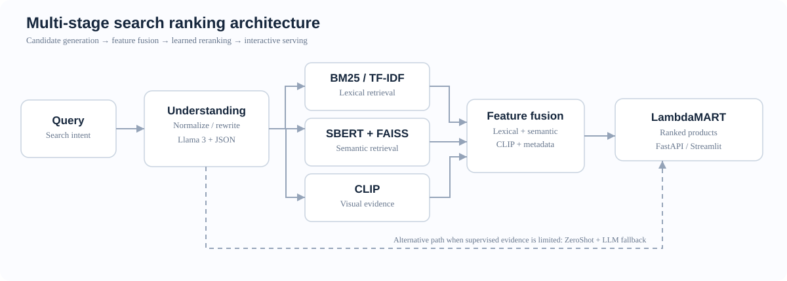
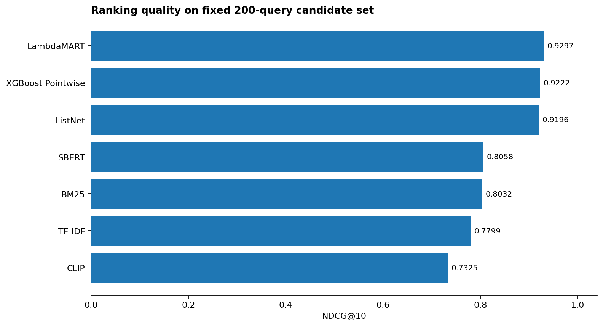
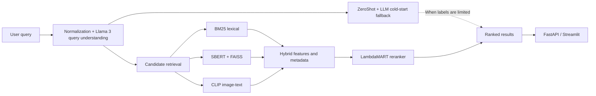
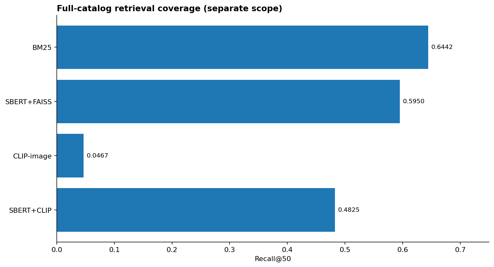

# E-Commerce Search & Learning-to-Rank System

**An end-to-end product search prototype, developed over eight weeks using the public Amazon Reviews (2018) product ecosystem.** The project explores query understanding, lexical and semantic retrieval, multimodal signals, supervised ranking, cold-start adaptation, and interactive serving.

> **Portfolio project notice:** This is an independent technical project using a public Amazon-related dataset. This repository is not an official Amazon source-code release and does not imply endorsement by or affiliation with Amazon.com, Inc. Original implementation notebooks, data and model artifacts are not part of this starter snapshot; add reviewed versions before advertising the repository as fully reproducible.



## Highlights

| Metric | Reported result | Evaluation setting |
|---|---:|---|
| Best ranking NDCG@10 (LambdaMART) | **0.9297** | Fixed 200-query candidate reranking benchmark |
| Relative NDCG@10 improvement vs BM25 | **+15.75%** | Same 200-query reranking benchmark |
| LambdaMART MRR | **0.9667** | Same 200-query reranking benchmark |
| ZeroShot+LLM NDCG@10 | **0.8990** | Separate 45-query cold-start holdout |
| Fresh mean serving latency | **83.94 ms** | Optimized serving benchmark |
| Fresh P95 serving latency | **99.91 ms** | Optimized serving benchmark |

**Results above are transcribed from the project's final technical report, not independently reproduced during this repository packaging step.** Retrieval, reranking, cold-start and latency metrics come from different test scopes and should not be compared directly.



## The problem

Search relevance needs more than a single model: a useful system must retrieve relevant products from a large catalog, rank the candidate set well, handle queries with little supervised evidence, and serve results with acceptable latency.

This project evaluates four distinct questions:
1. **Candidate retrieval:** can relevant items be found in the full catalog?
2. **Reranking quality:** can highly relevant candidates be placed near the top?
3. **Cold-start quality:** can limited-label queries be handled well?
4. **Serving:** can the integrated system respond quickly enough for an interactive demo?

## System design



## Experimental roadmap

| Week | Focus | Representative tools |
|---|---|---|
| 1 | Data cleaning, query normalization, relevance labeling, EDA | Python, pandas, Parquet |
| 2 | Lexical retrieval and ranking baselines | TF-IDF, BM25, cosine similarity |
| 3 | Query intent, attribute extraction, rewriting | Llama 3, Ollama, structured JSON |
| 4 | Semantic/multimodal retrieval and coverage-aware fusion | SBERT, FAISS, CLIP |
| 5 | Supervised learning-to-rank and ablation | XGBoost, LambdaMART, ListNet |
| 6 | Cold-start benchmarking | ZeroShot adapter, LLM relevance |
| 7 | System integration, serving and latency | FastAPI, Streamlit, caching |
| 8 | Unified benchmarks, error analysis, report | NDCG, MRR, MAP, Recall |

## Results

### 200-query reranking (fixed candidate set)

| Model | NDCG@10 | MAP@10 | MRR |
|---|---:|---:|---:|
| **LambdaMART** | **0.9297** | 0.9072 | **0.9667** |
| XGBoost Pointwise | 0.9222 | **0.9133** | 0.9625 |
| ListNet | 0.9196 | 0.8923 | 0.9533 |
| SBERT | 0.8058 | 0.7286 | 0.7783 |
| BM25 | 0.8032 | 0.7372 | 0.7958 |
| TF-IDF | 0.7799 | 0.6940 | 0.7358 |
| CLIP | 0.7325 | 0.7338 | 0.7050 |

The **15.75%** improvement is computed as `(0.9297 / 0.8032 - 1) × 100` on the **same fixed reranking benchmark**.

### Full-catalog retrieval (different 200-query evaluation)

BM25 achieved the highest reported **Recall@50 = 0.6442**. SBERT+CLIP achieved **NDCG@10 = 0.8066** but lower **Recall@50 = 0.4825**, highlighting a coverage-versus-ordering trade-off.



### Ablation

Removing metadata/structural features reduced NDCG@10 by 0.0388; removing lexical features reduced it by 0.0321. Semantic and multimodal evidence was complementary, not a wholesale replacement for lexical matching.


### Cold start

On a **separate 45-query holdout**, ZeroShot+LLM reached **0.8990 NDCG@10**, versus the LambdaMART reference of **0.9050** on that holdout. These figures are not interchangeable with the primary reranking benchmark.

### Latency & diagnostics

Optimized fresh mean latency was **83.94 ms** (P95 **99.91 ms**) vs the earlier mean **212.86 ms**, a **60.57%** reduction. In the fixed 200-query reranking set, **37 queries** had NDCG@10 below 0.90; leading categories included top-1 inversions and ambiguous/subjective queries.

## Repository layout

```text
ecommerce-search-ranking-system/
├── README.md
├── assets/                     # Architecture and benchmark figures
├── results/                    # Report-transcribed, small aggregate CSVs
├── docs/                       # Evaluation protocol and reproduction notes
├── notebooks/                  # Import reviewed Week 1–8 Colab notebooks
├── app/                        # Import reviewed FastAPI/Streamlit source
├── scripts/                    # Chart regeneration, notebook import, safety checks
└── .github/workflows/          # Lightweight repository checks
```

## Reproduction and implementation status

This repository starter preserves a **report-backed results snapshot**, rather than pretending that all experiments can run from it immediately. The original Colab notebooks and ZIP deliverables must be reviewed and imported separately. Some experiments depend on large datasets, pretrained weights, upstream ZIP outputs, Google Colab, and (for Week 3) a local Ollama/Llama 3 environment.

- Start with [`docs/reproduction.md`](docs/reproduction.md) for original notebook names and dependency constraints.
- Run `python scripts/verify_report_metrics.py` to check the published aggregate comparisons.
- Use `python scripts/import_notebooks.py --source "/path/to/your/downloads" --apply` to stage approved notebooks with outputs removed. This **does not execute** the notebooks.
- Add reviewed Week 7 API/Streamlit code from the original archives before claiming the demo is runnable.
- Run `python scripts/preflight_repo.py` before publishing.

## Limitations

The report notes partly proxy-based relevance labels, limited manual validation, different evaluation scopes, image-availability dependence, and the absence of real online conversion/user-satisfaction metrics. Follow-up work could add query-adaptive hybrid fusion, hard-negative mining, a lexical safety path, stronger human relevance audits and online evaluation.

## Data & attribution

Dataset provenance: [Amazon Review Data (2018), Ni et al.](https://nijianmo.github.io/amazon/). Check the original dataset's terms and applicable permissions before redistributing raw or derivative files. Do **not** commit credentials, unreviewed datasets, large model checkpoints, proprietary employer code or personally identifiable information.

A software license is intentionally not included in this starter because you should choose one only after confirming ownership and distribution rights for the code and data.
