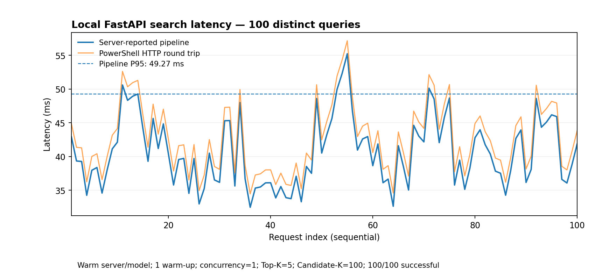

# Local FastAPI runtime validation — 100-query benchmark

**Executed:** November 17, 2026, 11:41 AM Pacific (local Windows machine, CPU).  
**System:** 10,000-product catalog; 10,000-item FAISS index; 29-feature LambdaMART reranker.  
**Endpoint:** `POST /search` at `http://127.0.0.1:8000/search`.  
**Requests:** 100 distinct product search queries; each with `top_k=5`, `candidate_k=100`.  
**Result:** 100/100 requests returned five products; zero failures; all server pipeline times under 200 ms.



## Observed latency

| Measure | Server pipeline | Client HTTP round trip |
|:--|--:|--:|
| Mean | 40.65 ms | 42.65 ms |
| P50 | 39.71 ms | 41.73 ms |
| P95 | 49.27 ms | 51.29 ms |
| P99 | 52.33 ms | 54.33 ms |
| Min | 32.47 ms | 34.46 ms |
| Max | 55.24 ms | 57.16 ms |

## Average server-side stage breakdown

| Stage | Mean (ms) | Share of total pipeline |
|:--|--:|--:|
| SBERT query embedding | 7.58 | 18.6% |
| FAISS candidate retrieval | 0.90 | 2.2% |
| Runtime feature generation | 29.62 | 72.9% |
| LambdaMART reranking | 2.48 | 6.1% |

Stage timers omit a small residual of approximately 0.07 ms per request. Mean client-side HTTP/serialization overhead was about 2.00 ms.

## Protocol and reproducibility

- A single warm-up request was sent before the 100 measurements; it was not included in the reported statistics.
- The 100 queries were generated as 20 product themes × five natural-language templates, run **sequentially** (`concurrency=1`) against an already-loaded API.
- Percentiles use the **nearest-rank** definition over the 100 successful observations. The P99 is the 99th ordered observation, not a distributional guarantee.
- Server pipeline timing and the PowerShell client round-trip timing are **different measurement boundaries**.
- This is evidence of **local functional correctness and latency under a warm, non-concurrent workload**, not a clean model cold start, stress test, production SLA, or ranking relevance benchmark.
- Validation was performed on the user's local machine; the repository author should preserve environment/hardware details if publishing comparative claims.

## Raw evidence and rerun

- [Per-request CSV (100 rows)](../results/benchmark_100_queries.csv)
- [Original PowerShell test script](../scripts/benchmark_100_queries.ps1)

Rerun from the repository root, after starting FastAPI locally:

```powershell
powershell.exe -NoProfile -ExecutionPolicy Bypass -File .\scripts\benchmark_100_queries.ps1
```

This creates `scripts/benchmark_results/` by default; generated CSV files can then be inspected and selectively published. Avoid uploading data/model artifacts or secrets.
